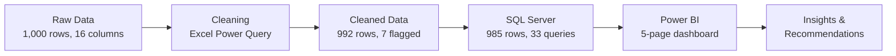

# Loan Default Risk Analysis

An end-to-end BFSI analytics project: a raw (synthetic) loan dataset is cleaned in **Excel Power Query**, analysed with **SQL Server**, and presented in a 5-page interactive **Power BI** dashboard.

> **Note:** All data is synthetic. It does not represent any real bank or customer. All monetary values are in INR.

---

## Table of Contents
1. [Project Overview](#1-project-overview)
2. [Business Problem](#2-business-problem)
3. [Project Objectives](#3-project-objectives)
4. [Tools & Technologies](#4-tools--technologies)
5. [Dataset Information](#5-dataset-information)
6. [Data Cleaning](#6-data-cleaning)
7. [SQL Analysis](#7-sql-analysis)
8. [Power BI Dashboard](#8-power-bi-dashboard)
9. [Key Insights & Recommendations](#9-key-insights--recommendations)
10. [Project Workflow](#10-project-workflow)
11. [Repository Structure](#11-repository-structure)
12. [How to Reproduce](#12-how-to-reproduce)

---

## 1. Project Overview

This project analyses a portfolio of retail loans from a bank's point of view. It looks at **who defaults, why, how much money is at risk, how much is recovered, and which loans are already overdue**.

The work follows the process a bank data analyst would use: take a messy raw extract, clean and document every fix, answer business questions with SQL, and turn the results into a dashboard that decision-makers can filter and explore.

## 2. Business Problem

A bank lending to retail customers loses money when borrowers stop paying. The credit risk and collections teams need clear answers to questions such as:

- How many loans have defaulted, and how much money is stuck in those defaults?
- Which customer groups (by credit score, income, age, loan purpose, loan term, loan-to-income ratio) default the most?
- How much of the defaulted money is actually recovered?
- How many active loans are already overdue, and could they become the next defaults?
- Which loans or customers should be approved more carefully, and which should be watched more closely?

## 3. Project Objectives

- Clean the raw dataset and document every cleaning decision.
- Calculate portfolio KPIs: total loans, loan amount, outstanding balance, default rate, money at risk, recovery rate, delinquency rate.
- Find the customer and loan characteristics linked to higher default risk.
- Analyse repayment behaviour, recovery and delinquency (days-past-due buckets).
- Build an interactive Power BI dashboard with synced slicers.
- Turn the findings into practical risk-management recommendations.

## 4. Tools & Technologies

| Tool | Used for |
|---|---|
| **Microsoft Excel (Power Query)** | Data cleaning and standardisation (Advanced Editor / M code) |
| **SQL Server (SSMS)** | Table design (primary key, data types), KPI and business-question queries (T-SQL) |
| **Power BI Desktop** | Data modelling, DAX measures, calculated columns, 5-page interactive dashboard |
| **Git / GitHub** | Version control and project hosting |

## 5. Dataset Information

| Item | Details |
|---|---|
| Raw records | **1,000** loan records |
| Raw columns | **16** |
| Data type | Synthetic (no real customers) |
| Currency | INR |
| Loan dates | 01-Jan-2021 to 31-Aug-2026 |
| Reporting snapshot | 31-Oct-2026 |
| Loan purposes | Personal, Education, Medical, Home Improvement, Debt Consolidation |
| Loan terms | 12, 24, 36, 48, 60 months |
| Loan status | Repaid, Active, Default (Default = instalment unpaid for 90+ days) |

**Columns:** `Customer_ID`, `Age`, `Annual_Income`, `Credit_Score`, `Loan_ID`, `Loan_Date`, `Loan_Amount`, `Interest_Rate`, `Loan_Purpose`, `Loan_Term_Months`, `EMI_Amount`, `Payment_Due_Date`, `Days_Past_Due`, `Outstanding_Balance`, `Recovery_Amount`, `Loan_Status`.

About 4.5% of the raw rows contain intentionally injected data-quality issues (missing values, duplicates, invalid values, wrong data types, inconsistent labels, impossible dates). See [`Dataset/data_dictionary.md`](Loan%20Default%20Risk%20Analysis/Dataset/data_dictionary.md) and [`Dataset/data_quality_issue_summary.md`](Loan%20Default%20Risk%20Analysis/Dataset/data_quality_issue_summary.md).

After cleaning, two audit columns are added (`Data_Quality_Flag` and `What We Do` / `What_We_Do`), so the cleaned file has 18 columns.

## 6. Data Cleaning

Cleaning was done in **Excel Power Query**. Every fix is recorded row by row in the `What We Do` column, so nothing is changed silently.

**Record flow:** 1,000 raw rows → 8 exact duplicates removed → **992 cleaned rows** → 7 rows flagged *Needs Investigation* and excluded → **985 rows used for analysis**.

| Issue type | How it was handled |
|---|---|
| **Duplicate records** | Removed by `Loan_ID` (8 rows). |
| **Missing values** | Filled from the customer's other loans where possible (e.g. income, age, credit score); otherwise a documented fill (median credit score 659; interest rate set to the value consistent with the EMI; missing loan purpose set to `Unknown`; missing dates filled with the documented date). |
| **Invalid values / outliers** | Credit scores outside 300-850 corrected from the customer's other records; an impossible age (142) set to 28 from the same customer's other loan; an interest-rate outlier (58.5) replaced with a rate consistent with its EMI. |
| **Incorrect data types** | Text such as `"38 yrs"`, thousands separators, and `0.1312` (a fraction instead of a percent) converted to proper numbers; date columns converted to the Date type. |
| **Inconsistent `Loan_Status`** | Standardised capitalisation, whitespace and spelling to `Active`, `Repaid` or `Default`. |
| **Inconsistent balances** | `Outstanding_Balance` of Repaid loans set to 0. |
| **Records that could not be safely fixed** | Flagged as `Needs Investigation` and excluded from the analysis (see below). |

**Rows flagged and excluded (7):**

| Loan_ID | Reason |
|---|---|
| LN100751 | Missing `Days_Past_Due`; loan status needs verification |
| LN100280 | Default loan with zero outstanding balance and zero recovery |
| LN100357 | Invalid payment due date (month 13), set to blank |
| LN100359 | Loan amount of 25,500,000 is unusually high |
| LN100780 | Payment due date is before the loan date |
| LN100875 | Recovery amount exceeds the loan amount |
| LN100926 | Outstanding balance exceeds the loan amount |

Files: [`Excel/Advanced Editor Code Full Correct.txt`](Loan%20Default%20Risk%20Analysis/Excel/Advanced%20Editor%20Code%20Full%20Correct.txt) (Power Query M code) and [`Excel/Corrected project.csv`](Loan%20Default%20Risk%20Analysis/Excel/Corrected%20project.csv) (992 cleaned rows with flags).

## 7. SQL Analysis

The 985 analysis rows were loaded into SQL Server (database `LOANDEFAULTRISKANALYSIS`, table `LDR`, primary key on `Loan_ID`, amount columns as `DECIMAL(12,2)`). The script contains **33 queries in 4 sections**:

| Section | Business questions |
|---|---|
| **1. Portfolio overview** | Total loans, total loan amount, total outstanding, averages (loan, interest rate, age, income, credit score), loans by purpose, loan-term distribution, single vs multiple-loan customers |
| **2. Credit risk** | Defaulted loans, default rate, defaulted outstanding, money at risk, default rate by income group, loan purpose, credit-score group, loan term and age group, loan-to-income analysis, customer risk segmentation |
| **3. Repayment behaviour** | Repaid vs Active vs Default, outstanding balance analysis, recovery amount analysis, recovery rate, repayment behaviour by loan purpose |
| **4. Delinquency** | Delinquency rate, delinquency by income group and loan purpose, days-past-due buckets, overdue loan analysis |

**Key definitions**

- **Default rate** = Defaulted loans / (Repaid + Defaulted loans). Active loans are excluded because their final outcome is not known yet.
- **Money at risk** = Outstanding balance of Active + Default loans.
- **Recovery rate** = Total recovery / Outstanding balance of defaulted loans.
- **Delinquency rate** = Active and Default loans with `Days_Past_Due > 0` / all Active and Default loans.

**Headline KPIs**

| KPI | Value |
|---|---|
| Total loans | 985 |
| Total loan amount | ₹24,02,80,000 |
| Total outstanding | ₹7,66,81,661.61 |
| Defaulted loans | 87 of 513 settled loans |
| **Default rate** | **16.96%** |
| Defaulted outstanding | ₹1,51,53,270.20 |
| Total recovery | ₹39,88,489.37 |
| **Recovery rate** | **26.32%** |
| Unrecovered amount | ₹1,11,64,780.83 |
| **Delinquency rate** | **25.58%** (143 of 559 open loans) |

Files: [`SQL/01_Create_Database_And_Table.sql`](Loan%20Default%20Risk%20Analysis/SQL/01_Create_Database_And_Table.sql) (create table + insert) and [`SQL/All Answers Correct.sql`](Loan%20Default%20Risk%20Analysis/SQL/All%20Answers%20Correct.sql) (all queries).

## 8. Power BI Dashboard

A 5-page dashboard with slicers for **Loan Year, Loan Purpose, Loan Term and Loan Status**, synced across pages. It uses calculated columns (income group, credit-score group, age group, loan-to-income group, risk segment, days-past-due bucket, loan year) and DAX measures for every KPI.

**Page 1: Executive Summary**


**Page 2: Default Risk Analysis**


**Page 3: Credit Risk & Customer Segmentation**


**Page 4: Repayment & Recovery**


**Page 5: Delinquency & Overdue**


Files: [`PowerBI/Loan Default Risk Project.pbix`](Loan%20Default%20Risk%20Analysis/PowerBI/Loan%20Default%20Risk%20Project.pbix) and [`PowerBI/completed.pdf`](Loan%20Default%20Risk%20Analysis/PowerBI/completed.pdf) (PDF export of all pages).

## 9. Key Insights & Recommendations

### Key insights

- **Overall:** 87 of 513 settled loans defaulted (**16.96%**). Another 472 loans (47.92% of the portfolio) are still Active, so their final outcome is not known yet.
- **Credit score is the strongest signal.** Default rate by credit-score group: Poor **32.61%**, Fair 19.02%, Good 16.51%, Excellent **1.54%**.
- **Longer loans default more.** Default rate by loan term: 12 months 7.26%, 24 months 14.20%, 36 months 20.29%, 48 months 24.53%, 60 months **44.83%**.
- **Loan-to-income (LTI) matters.** Default rate rises from 10.14% (Low LTI) to 18.18% (Medium), 27.59% (High) and **37.93%** (Very High LTI).
- **Customer risk segments** (credit score + LTI): High Risk 22.58%, Medium Risk 12.24%, Low Risk 0.00% (38 loans, no defaults).
- **Lower income, higher risk.** Low income 17.92%, Medium income 16.80%, High income 9.52%.
- **Loan purpose:** Medical is the riskiest (21.54%), then Personal (19.88%), Debt Consolidation (18.00%) and Education (14.10%). Home Improvement is the safest (11.11%).
- **Age:** customers aged 51-65 have the lowest default rate (8.51%); the other age groups are between 16.94% and 18.71%.
- **Recovery is weak.** Only 26.32% of the defaulted outstanding was recovered. 24 of the 87 defaulted loans have no recovery at all, leaving about ₹1.12 crore unrecovered.
- **Delinquency:** 25.58% of open loans are overdue. 56 Active loans are already overdue (up to 86 days), which puts them close to the 90-day default line. Delinquency is highest for Medical loans (29.51%) and low-income customers (27.47%).
- **Customers:** 225 customers (31.38%) hold more than one loan; 492 (68.62%) hold a single loan.

### Recommendations

1. **Tighten approval for weak credit profiles.** Apply stricter limits, higher pricing, or a guarantor/collateral requirement for Poor credit scores.
2. **Limit long tenures for risky profiles.** 60-month loans default about six times as often as 12-month loans; restrict long tenures for low-score or high-LTI applicants.
3. **Set an LTI cap or extra checks.** Loans above 50% of annual income should need additional review.
4. **Use a combined risk scorecard** (credit score + LTI + loan term) instead of a single cut-off.
5. **Watch Medical and Personal loans more closely,** since they show the highest default and delinquency rates.
6. **Start early-warning collections** for the 56 Active loans that are already overdue, so they do not roll into default.
7. **Strengthen the recovery process.** Prioritise the 24 defaulted loans with zero recovery and review how recovery is handled after default.

### Limitations

- The data is synthetic, so the percentages show analytical patterns, not real bank performance.
- Active loans are excluded from default rates, and recent loan years contain mostly Active loans, so default rates should not be compared across loan years.
- Some segments are small (for example, one loan with `Unknown` purpose, and 38 Low Risk loans), so their rates should be read carefully.

## 10. Project Workflow



**Raw Data → Cleaning → SQL → Power BI → Insights**

## 11. Repository Structure

```
Loan-Default-Risk-Analysis/
├── README.md
└── Loan Default Risk Analysis/
    ├── Dataset/
    │   ├── loan_default_risk_dataset.csv                     (raw data, 1,000 rows)
    │   ├── data_dictionary.md
    │   ├── data_quality_issue_summary.md
    │   └── Loan_Default_Risk_Analysis_Project_Guide.docx.pdf
    ├── Excel/
    │   ├── Advanced Editor Code Full Correct.txt             (Power Query cleaning code)
    │   └── Corrected project.csv                             (992 cleaned rows with flags)
    ├── SQL/
    │   ├── 985 records perfect csv.csv                       (final analysis data)
    │   ├── 01_Create_Database_And_Table.sql                   (create DB + table + inserts)
    │   └── All Answers Correct.sql                           (analysis queries)
    ├── PowerBI/
    │   ├── Loan Default Risk Project.pbix
    │   └── completed.pdf
    └── Screenshots/
        ├── 01_Executive_Summary.jpg
        ├── 02_Default_Risk_Analysis.jpg
        ├── 03_Customer_Segmentation.jpg
        ├── 04_Repayment_Recovery.jpg
        └── 05_Delinquency_Analysis.jpg
```

## 12. How to Reproduce

1. **Get the project:**  
   `git clone https://github.com/sahil-bfsi-analytics/Loan-Default-Risk-Analysis.git`

2. **Clean the data:** Load the raw CSV into an Excel table named `Table1` and run the Power Query code from `Loan Default Risk Analysis/Excel/Advanced Editor Code Full Correct.txt`.

3. **Prepare the analysis set:** Keep the rows where `Data_Quality_Flag = "No Flag"` (985 rows).

4. **SQL Server:** Run `Loan Default Risk Analysis/SQL/01_Create_Database_And_Table.sql` to create the `LDR` table and insert the 985 rows, then run `Loan Default Risk Analysis/SQL/All Answers Correct.sql`.

5. **Power BI:** Open `Loan Default Risk Analysis/PowerBI/Loan Default Risk Project.pbix`. If the data source path asks for an update, point it to `Loan Default Risk Analysis/SQL/985 records perfect csv.csv` (Transform data → Data source settings).